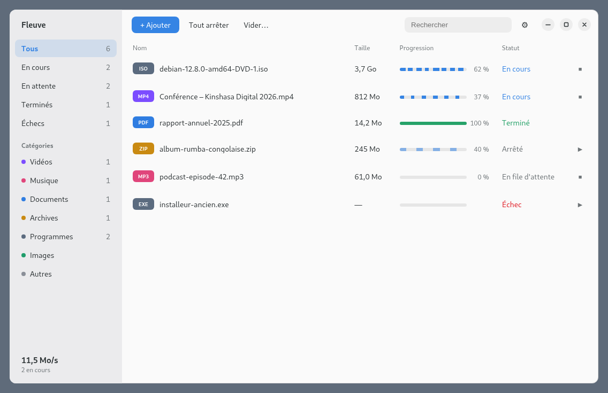
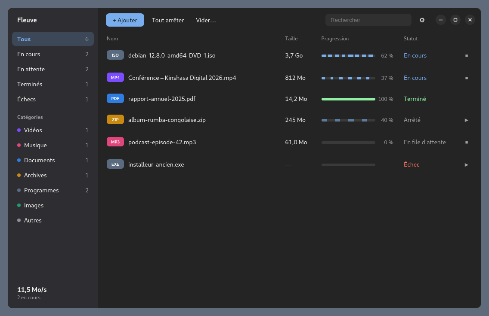

# Fleuve

**A fast, multi-connection download manager for macOS, Linux and Windows**, inspired by how Internet Download Manager (IDM) works.
Personal project by Gespère BONAZEBI — a **functional** reverse-engineering: no IDM code or files are reused.



<details>
<summary>Dark mode</summary>



</details>

## Features

- **Multi-connection acceleration**: up to 32 connections per file, with IDM-style dynamic segmentation (every free connection takes over half of the largest remaining segment).
- **Resume anywhere**: state is saved every 2 seconds; downloads resume after a pause, a network drop or a reboot.
- **Browser integration**: a Chrome extension (also Edge, Brave, Arc) that intercepts downloads, adds "Download with Fleuve" to the right-click menu and detects the videos and audio on the page.
- **HLS video capture** (.m3u8): the best quality is picked automatically, chunks are downloaded in parallel and then merged.
- **Site videos** (YouTube, Vimeo, …) through [yt-dlp](https://github.com/yt-dlp/yt-dlp) when it is installed.
- **Choose the video quality**: in **Settings → Video quality**, pick *Ask every time* (Fleuve detects the qualities the site really offers and lets you choose, with the estimated size), *Always the best*, or a maximum (2160p to 360p). The quality can also be chosen for each link in the **Add** dialog. Works for HLS streams and site videos.
- **Queue, scheduler, speed limit**, and automatic sorting by category.
- **Native look on each system**: macOS style on the Mac; on Linux, a clean GNOME-inspired theme with an integrated header bar and rounded window corners. Light and dark mode follow the system.

Fleuve never bypasses any protection: encrypted or DRM-protected streams are refused.

## Download

Ready-made installers for **Linux** (`.deb`, `.rpm`, `.AppImage`), **Windows** (`.msi`, `.exe`) and **macOS** (universal `.dmg`: Apple Silicon + Intel) are on the **[Releases](../../releases/latest)** page. Every push to `main` refreshes the files of the release matching the version in `src-tauri/tauri.conf.json`; change that version to start a new release.

The macOS build runs in its own workflow (*Build macOS*), since GitHub's Mac machines are sometimes all busy: if its files are missing from the release, start it again from **Actions → Build macOS → Run workflow**. Each run's files are also kept under *Artifacts* in the **Actions** tab.

The apps are not signed:
- **macOS**: on first launch, right-click `Fleuve.app` → **Open**.
- **Windows**: in the SmartScreen warning, click **More info → Run anyway**.

## Build from source

### Requirements

| System | Command |
| --- | --- |
| macOS | `xcode-select --install` and `brew install node` |
| Debian / Ubuntu | `sudo apt install libwebkit2gtk-4.1-dev librsvg2-dev libayatana-appindicator3-dev libxdo-dev build-essential libssl-dev` |
| Windows | [Microsoft C++ Build Tools](https://visualstudio.microsoft.com/visual-cpp-build-tools/) and Node.js 20+ (WebView2 ships with Windows 10/11) |

Then install Rust on every system:

```bash
curl --proto '=https' --tlsv1.2 -sSf https://sh.rustup.rs | sh
```

### Run and build

```bash
npm install
npm run tauri dev      # development mode, hot reload
npm run tauri build    # final application
```

Output, under `target/release/bundle/`:

| System | Files |
| --- | --- |
| macOS | `macos/Fleuve.app`, `dmg/` installer — drag `Fleuve.app` into **Applications** |
| Linux | `deb/`, `rpm/`, `appimage/` — e.g. `sudo apt install ./target/release/bundle/deb/Fleuve_0.1.0_amd64.deb` |
| Windows | `msi/` and `nsis/` installers |

Universal macOS binary (Apple Silicon + Intel):

```bash
rustup target add x86_64-apple-darwin aarch64-apple-darwin
npm run tauri build -- --target universal-apple-darwin
```

### Site videos (optional)

| System | Command |
| --- | --- |
| macOS | `brew install yt-dlp ffmpeg` |
| Linux | `pipx install yt-dlp` (or `pip install --user yt-dlp`) and `sudo apt install ffmpeg` |
| Windows | `winget install yt-dlp.yt-dlp Gyan.FFmpeg` |

## Browser extension (Chrome, Edge, Brave, Arc)

1. Open `chrome://extensions` and turn on **Developer mode**.
2. Click **Load unpacked** and pick the `extension/` folder.
3. In Fleuve: **Settings → Extension token → Copy**.
4. In the extension options: paste the token, then **Test connection**.

The link goes through `127.0.0.1:47821`, local only, protected by the token.
If Fleuve is closed, the browser downloads normally.

## Tests

```bash
cargo test -p fleuve-core          # 24 tests: segmentation, resume, HLS, video quality, queue, speed limit, link security
cargo run -p fleuve-core --example sans_interface -- ./data ./downloads
```

## Project layout

| Folder | Role |
| --- | --- |
| `crates/fleuve-core/` | Rust engine: `engine.rs` (segments), `hls.rs`, `site.rs` (yt-dlp), `manager.rs` (queue, scheduler, persistence), `limiter.rs`, `server.rs` (browser link) |
| `src-tauri/` | Tauri app: commands called by the UI; `tauri.linux.conf.json` holds the Linux window settings |
| `src/` | React + TypeScript UI |
| `extension/` | Browser extension (Manifest V3) |
| `.github/workflows/` | macOS, Windows and Linux builds |

## App data

| System | Folder |
| --- | --- |
| macOS | `~/Library/Application Support/com.gesperebonazebi.fleuve/` |
| Linux | `~/.local/share/com.gesperebonazebi.fleuve/` |
| Windows | `%APPDATA%\com.gesperebonazebi.fleuve\` |

It contains `downloads.json` and `settings.json`.
